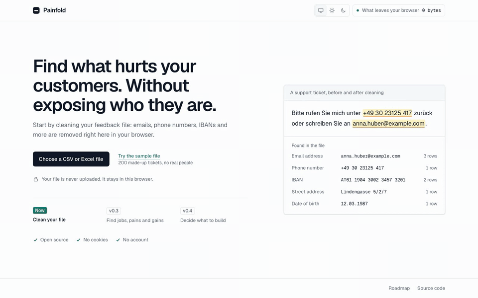
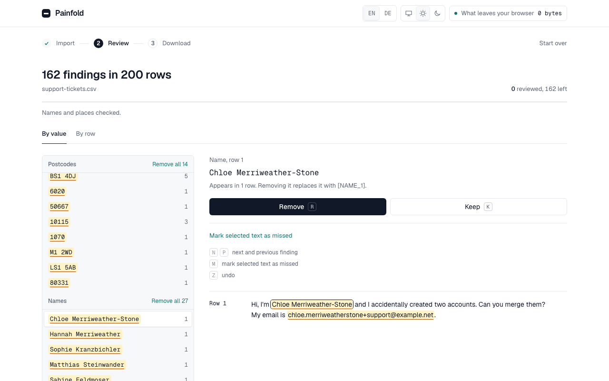
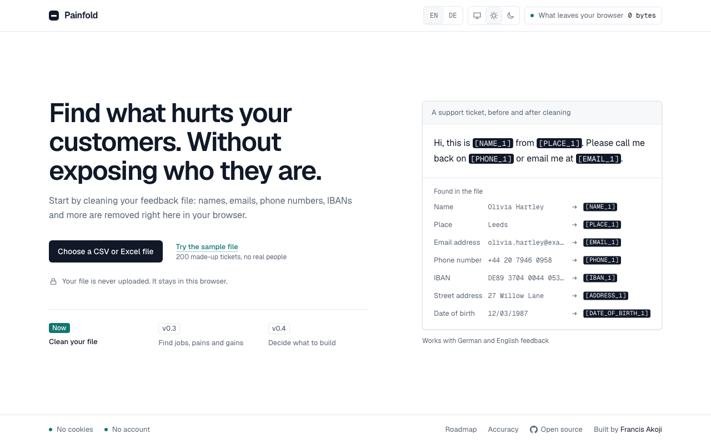
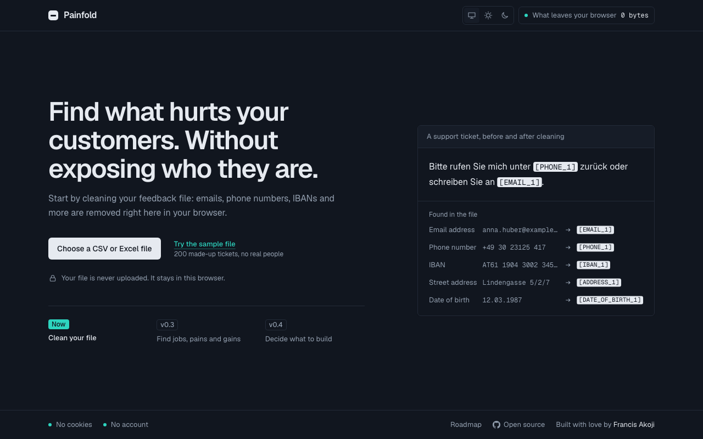
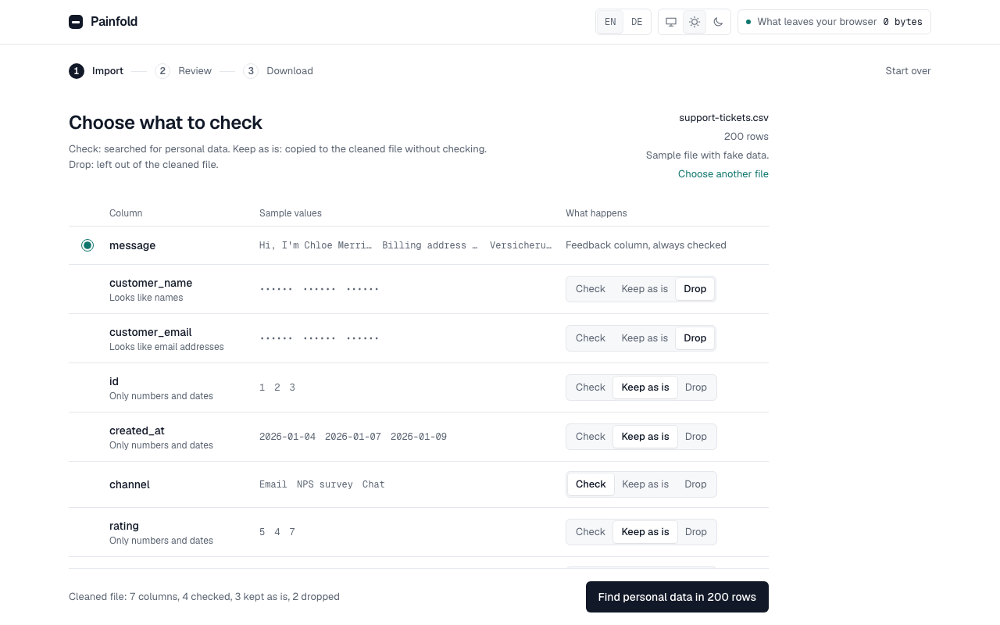
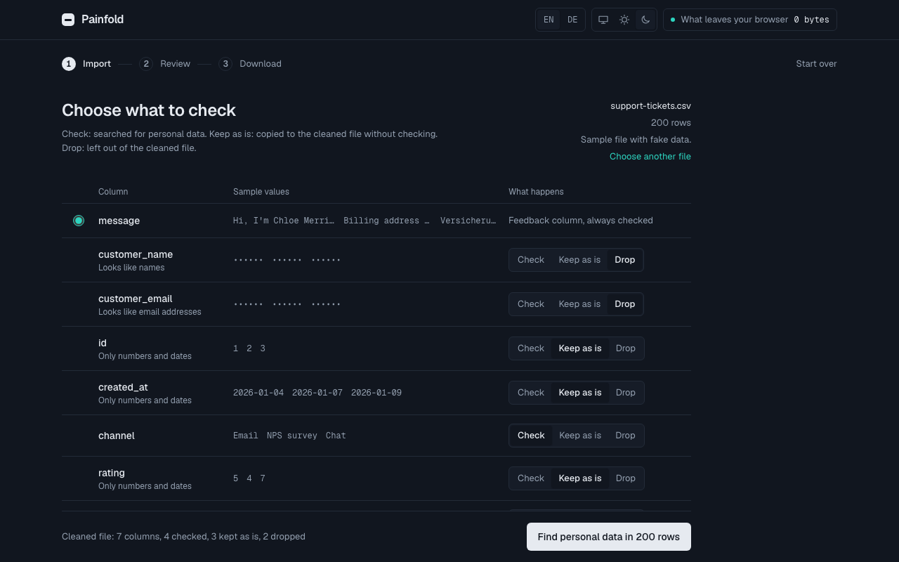
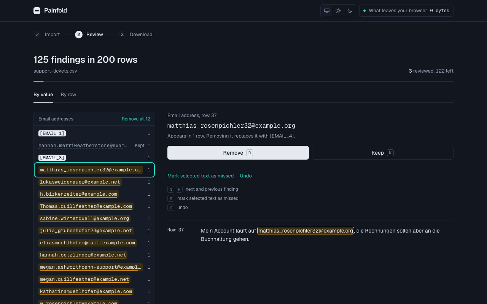
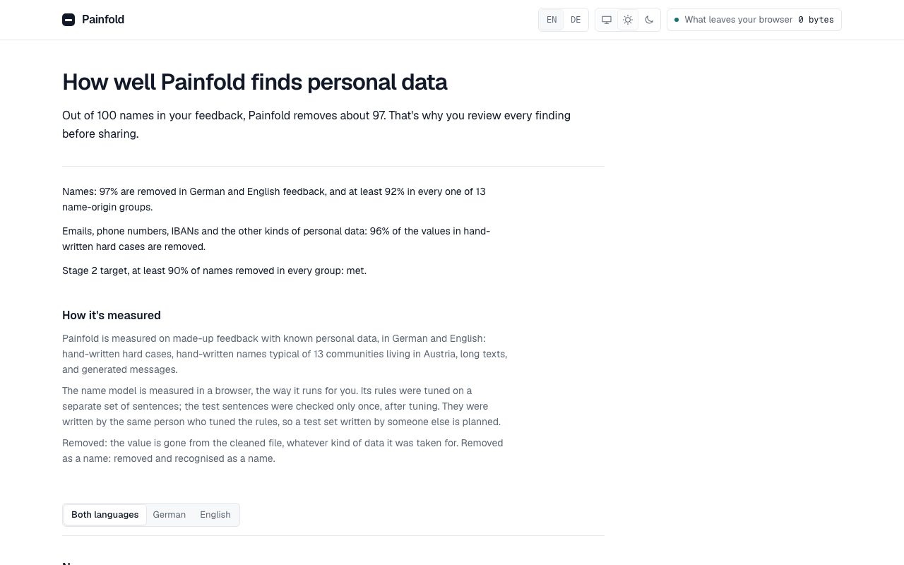
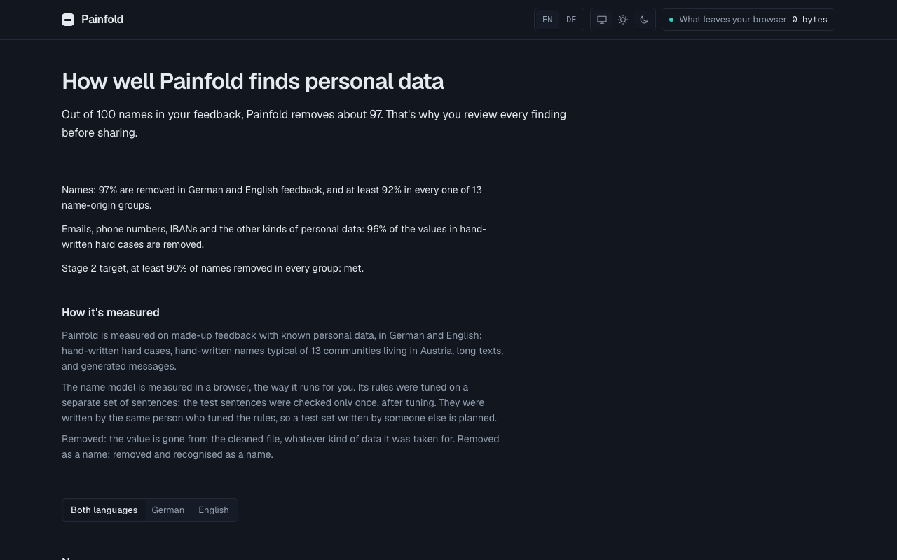

# Painfold

Find what hurts your customers, without exposing who they are.

Painfold turns customer feedback into an evidence-backed customer profile: the jobs customers are trying to get done, their pains and their gains. Personal data is removed in your own browser before any AI sees it, including German-language and Austrian data. The interface is in English and German ([painfold.com/de/](https://painfold.com/de/)).

**[Try it at painfold.com](https://painfold.com)**, with your own file or the built-in sample of 200 made-up support tickets.



## What it does

Removes personal data from a CSV or XLSX file in your browser, and lets you download the cleaned file.

- Finds email addresses, phone numbers (Austrian, German and international), IBANs, card numbers, Austrian social security numbers (SV-Nummer), VAT IDs, links, IP addresses, dates of birth, street addresses and postcodes, in German and English.
- Finds names and places with a name model that runs in your browser. It is downloaded once (152 MB, only when you ask), from this site, and kept in the browser until you remove it. Names are checked in the background while you review the other findings.
- You choose per column what is checked, kept as is or dropped, then review every finding by value or by row, and mark anything that was missed.
- Made for a laptop. On a phone the start screen explains Painfold and suggests a bigger screen; the full flow still works there, without the name model.
- The same value always gets the same placeholder, such as `[EMAIL_3]`.

Names and places are new in v0.2. Finding customer jobs, pains and gains follows in v0.3. See the [roadmap](ROADMAP.md) and the [changelog](CHANGELOG.md).

<picture>
  <source media="(prefers-color-scheme: dark)" srcset="docs/media/review-dark.png">
  
</picture>

<details>
<summary>More screenshots, in light and dark</summary>

| | Light | Dark |
| --- | --- | --- |
| Start |  |  |
| Columns |  |  |
| Review |  |  |
| Accuracy |  |  |

</details>

## Privacy

- Your file is never uploaded. It stays in your browser, and an end-to-end test checks that no request leaves it while you import, check and download.
- No cookies, no analytics, no tracking. The only things Painfold stores are your theme choice (Light or Dark, under `painfold-theme`; choosing System removes it) and your language choice (`painfold-language`), both in `localStorage`, and, if you download it, the name model (152 MB, in Cache Storage under `painfold-name-model`), which you can remove in Painfold.
- From v0.3, when analysis arrives: nothing is sent to an AI until you have reviewed what was removed, and the AI is your choice (your own API key or a local model).

## What you download

- **The cleaned file** (`<name>_cleaned.csv`): only your data, with dropped columns left out and every removed or unreviewed finding replaced by its placeholder. UTF-8 with a byte order mark, same delimiter as the original.
- **Formula protection:** cells that start with `=`, `+`, `-`, `@`, a tab or a carriage return get an apostrophe in front (`'=1+1`), so spreadsheets show them as text instead of running them ("CSV injection"). Plain numbers such as `-12,50` are left alone. Remove the apostrophe if another tool needs the original value.
- **The cleaning report** (`<name>_cleaning-report.txt`): what was replaced by type and count, what was kept, not reviewed or left out, the date, the Painfold version and the limits of automatic detection.

The list of original values behind each placeholder is never exported; it is gone when you close the tab.

## Accuracy and speed

Detection is measured per data type and language, on generated messages, on hand-written hard cases and on hand-written names from 13 communities living in Austria, and checked in CI. On the name test split, 97 % of names are removed (0.98 in German, 0.96 in English), and at least 92 % in every name-origin group; the model is measured in the browser, as users run it. On the hard cases nothing that only looks like personal data is removed, apart from one known case, and the known misses are listed. A 5,000-row file is cleaned in about 1.5 seconds; with the name model in the browser, names in it are checked in 70 to 115 seconds, in the background. Text that could identify someone together with other details (exact ages, "the only …", a job title with a small place) gets a warning, never removed on its own; on a small hand-written set every warning is found. Numbers, method and known gaps: [painfold.com/accuracy/](https://painfold.com/accuracy/) and, in full, [docs/accuracy.md](docs/accuracy.md).

Automatic detection can miss personal data, including names. Review the results before sharing the cleaned file.

## Run it locally

Requires Node 24 (pinned in `.nvmrc`).

```sh
nvm use
npm install
npm run dev
```

Tests, the build, CI, security headers, hosting and dependency policies, including why some dependency install scripts are denied: [docs/development.md](docs/development.md).

## License

Code: [MIT](LICENSE). Fonts in `app/assets/fonts/` (Geist and Geist Mono, by Vercel) are self-hosted under the SIL Open Font License 1.1; each folder contains its license.
