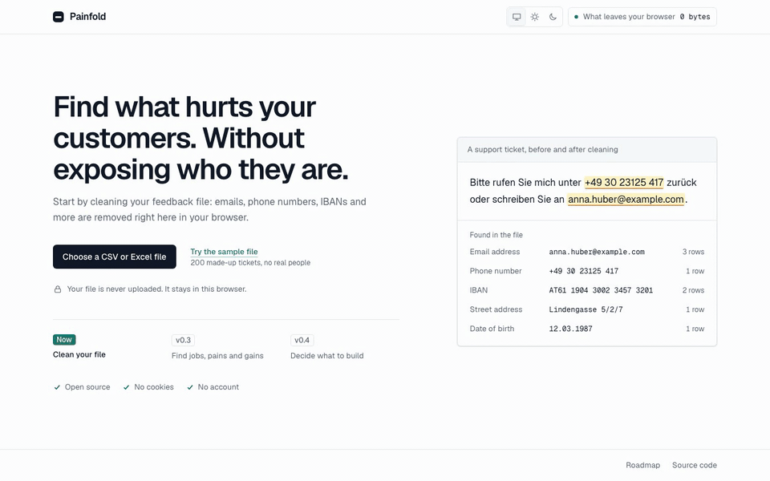

# Painfold

Find what hurts your customers, without exposing who they are. **[painfold.com](https://painfold.com)**

**Cleaning runs entirely in your browser and needs no key.** Painfold finds and removes personal data from customer feedback without uploading the file anywhere. **Analysis needs an Anthropic API key or a local Ollama model.** With Anthropic, only the cleaned text you approve is sent to Anthropic. With Ollama, nothing leaves your computer. ([How we prove it](docs/privacy.md#how-we-prove-it))



## What it does

- Removes personal data from a CSV or XLSX file in your browser, in German and English: emails, phone numbers, IBANs, names, places and more.
- You review every finding, by value or by row, and download the cleaned file.
- Analysis: finds your customers' jobs, pains and gains, with an AI you choose. Counts come from code, and every quote is checked word for word.

More in [docs/how-it-works.md](docs/how-it-works.md).

## Quick start

1. **Try the sample.** On [painfold.com](https://painfold.com), choose **Try an example**. Either clean the sample file (200 invented support tickets in German and English) step by step, or open a finished analysis of it. Neither needs a key, and the finished analysis sends nothing.
2. **Clean your own file.** Open a CSV or Excel file. Choose which columns are checked, kept as they are or left out. Review every finding, then download the cleaned file and its cleaning report. Nothing is uploaded. Optional: download the name model (152 MB, once) to find names and places too.
3. **Analyze.** On Analyze, choose where it runs:
   - **Anthropic:** paste your API key and test the connection. You'll see every cleaned text before you press Send.
   - **Ollama, on your computer:** install [Ollama](https://ollama.com) and a model (`ollama pull llama3.2:3b`), then allow painfold.com and restart Ollama. On macOS, run `launchctl setenv OLLAMA_ORIGINS "https://painfold.com"`; on Windows, `setx OLLAMA_ORIGINS "https://painfold.com"`; on Linux, add `Environment="OLLAMA_ORIGINS=https://painfold.com"` with `sudo systemctl edit ollama.service`. Chrome and Edge ask once to allow local network access; choose Allow. Ollama works in Chrome, Edge and Firefox, not in Safari.

## Privacy

- Your file never leaves your browser. There is no server that receives it. An end-to-end test checks it, and every end-to-end test fails if the page contacts another site ([How we prove it](docs/privacy.md#how-we-prove-it)).
- No cookies, no analytics, no tracking.
- Only cleaned text is sent to an AI, after you have reviewed it, and only to the one you choose: your own API key or a local model.
- Painfold keeps your theme and language choice in this browser. If you tick "Remember on this device", it also keeps your API key there, and nowhere else. The name model, if you download it, is kept there too, and the browser keeps each page's scroll position for the current tab. Never your file or findings.

Details, including a data-flow diagram, what you download, the tests behind each claim and what Painfold doesn't protect against: [docs/privacy.md](docs/privacy.md). To report a privacy or security problem privately, see [SECURITY.md](SECURITY.md).

## Accuracy

97 % of test names are removed, and at least 92 % in every name-origin group. In the analysis, Painfold finds 77 % of the pains and 64 % of the gains customers mention under the right theme, and about half of the gains it reports match people's labels; the known weaknesses are listed with the numbers. Numbers, method and known gaps: [painfold.com/accuracy/](https://painfold.com/accuracy/) and [docs/accuracy.md](docs/accuracy.md).

## Run it locally

Requires Node 24 (pinned in `.nvmrc`).

```sh
nvm use
npm install
npm run dev
```

## Links

- [Roadmap](ROADMAP.md) and [changelog](CHANGELOG.md)
- Docs: [development](docs/development.md) (tests, build, CI, hosting, security headers, dependency policies), [accuracy](docs/accuracy.md), [privacy](docs/privacy.md), [AI providers](docs/ai-providers.md)
- [Contributing](CONTRIBUTING.md), [security](SECURITY.md) and [feedback](docs/feedback.md): questions and ideas in [Discussions](https://github.com/akojif/painfold/discussions)
- License: [MIT](LICENSE). The self-hosted fonts in `app/assets/fonts/` (Geist and Geist Mono by Vercel, Sora by the Sora Project Authors) are under the SIL Open Font License 1.1; each folder contains its license.
