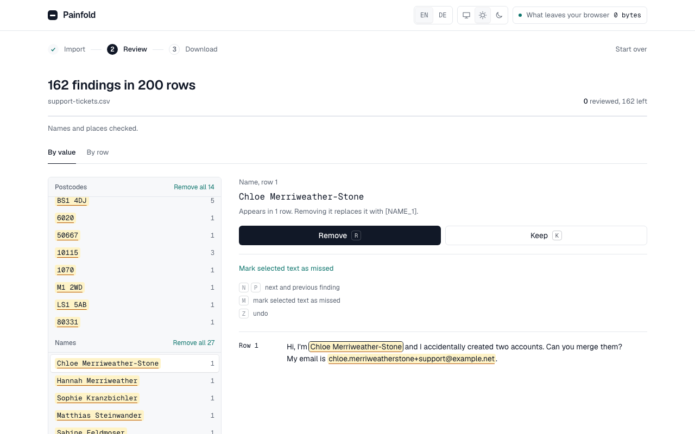
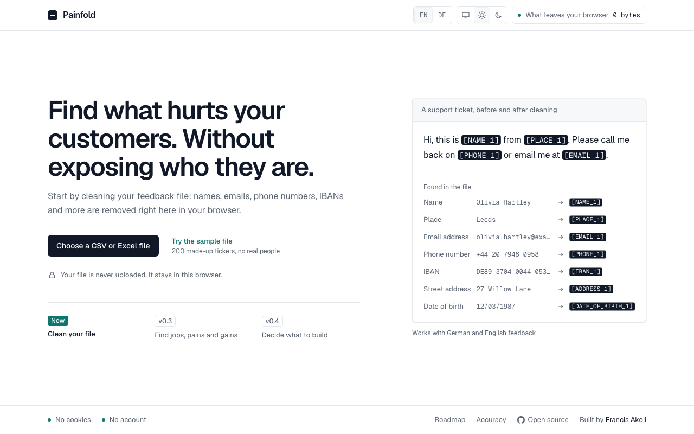
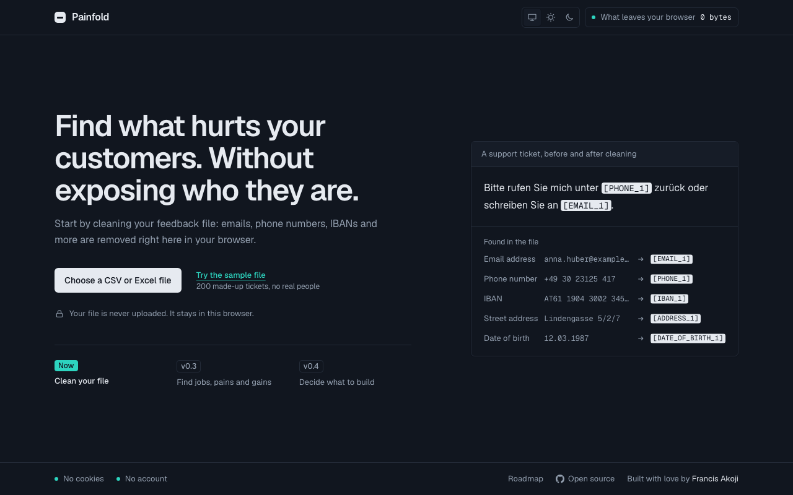
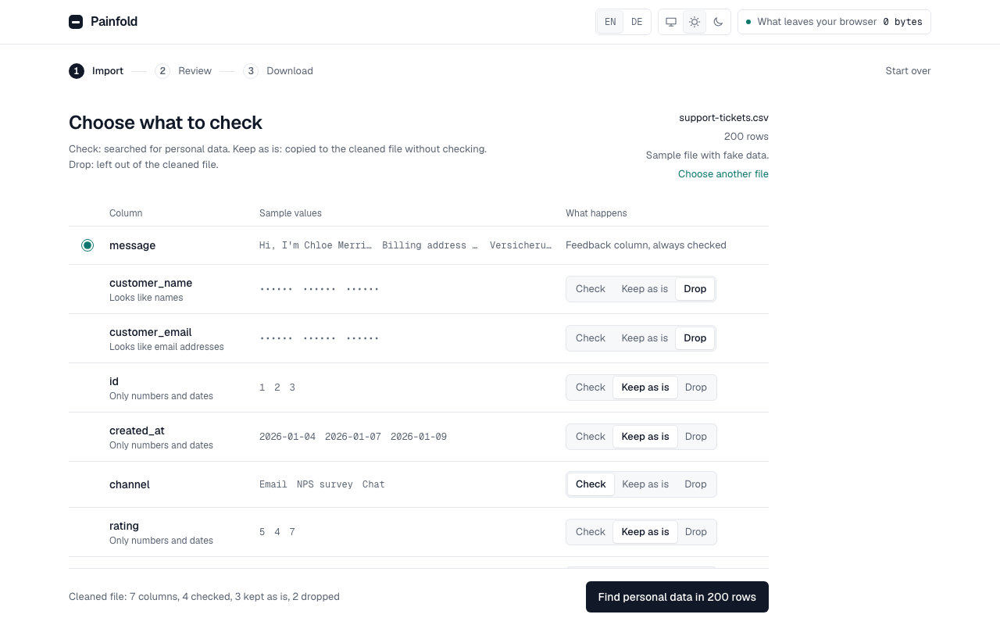
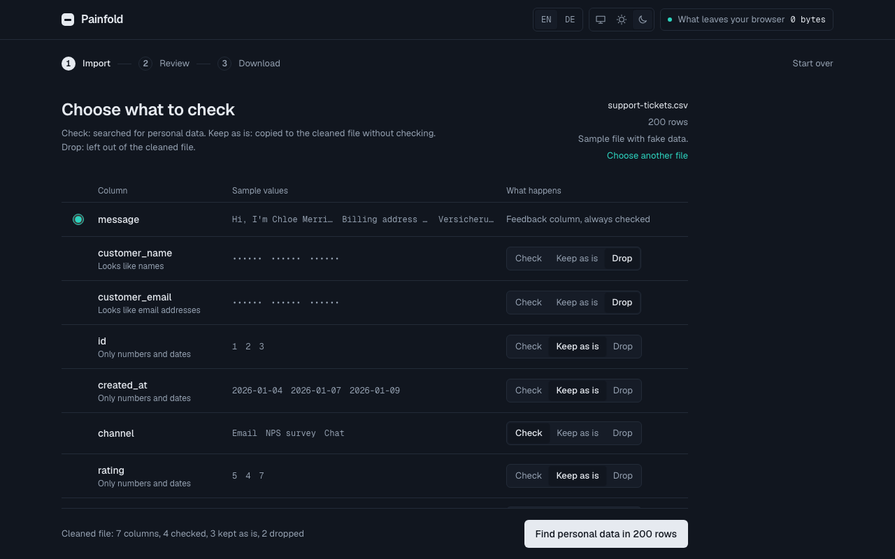
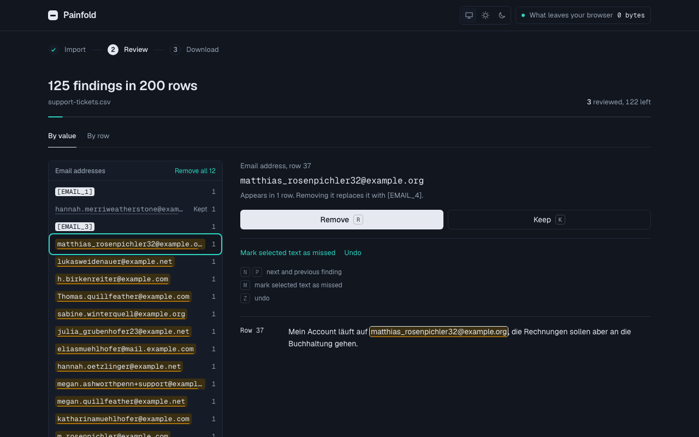
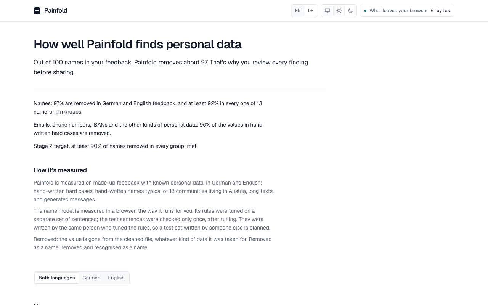
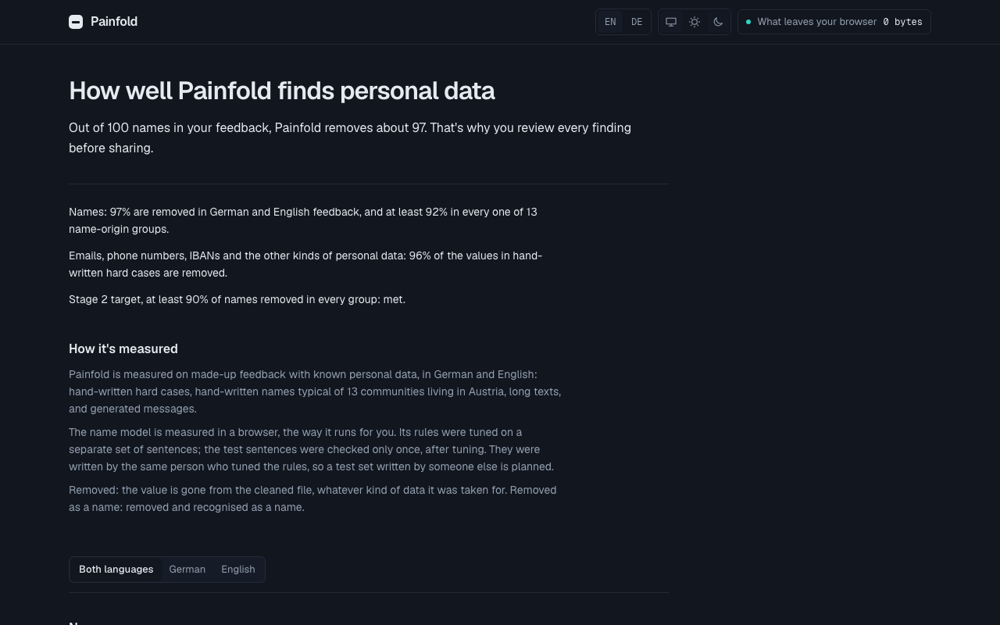

# How Painfold works

Painfold turns customer feedback into an evidence-backed customer profile: the jobs customers are trying to get done, their pains and their gains. Personal data is removed in your own browser before any AI sees it, including German-language and Austrian data. The interface is in English and German ([painfold.com/de/](https://painfold.com/de/)).

[Try it at painfold.com](https://painfold.com), with your own file or the built-in sample of 200 made-up support tickets.

## Cleaning a file

Painfold removes personal data from a CSV or XLSX file in your browser, and lets you download the cleaned file.

- Finds email addresses, phone numbers (Austrian, German and international), IBANs, card numbers, Austrian social security numbers (SV-Nummer), VAT IDs, links, IP addresses, dates of birth, street addresses and postcodes, in German and English.
- Finds names and places with a name model that runs in your browser. It is downloaded once (152 MB, only when you ask), from this site, and kept in the browser until you remove it. Names are checked in the background while you review the other findings.
- You choose per column what is checked, kept as is or dropped, then review every finding by value or by row, and mark anything that was missed.
- Needs a screen at least 768 pixels wide (a laptop or desktop). On a phone, Painfold shows what it does: the start screen, roadmap and accuracy page read fine, and the tool itself opens on a bigger screen.
- The same value always gets the same placeholder, such as `[EMAIL_3]`.

Names and places are new in v0.2. Finding customer jobs, pains and gains is new in v0.3. See the [roadmap](../ROADMAP.md) and the [changelog](../CHANGELOG.md).

What you download, and what Painfold stores, is in [privacy.md](privacy.md). The AI providers for the analysis are in [ai-providers.md](ai-providers.md).

## Screenshots

<picture>
  <source media="(prefers-color-scheme: dark)" srcset="media/review-dark.png">
  
</picture>

| | Light | Dark |
| --- | --- | --- |
| Start |  |  |
| Columns |  |  |
| Review |  |  |
| Accuracy |  |  |
