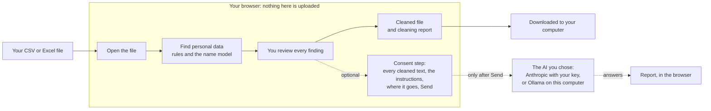

# Privacy, storage and downloads

## Privacy

- Your file is never uploaded. It stays in your browser, and an end-to-end test checks that no request leaves it while you import, check and download.
- No cookies, no analytics, no tracking.
- Analysis: nothing is sent to an AI until you have reviewed what was removed, only the cleaned text is sent, and the AI is your choice (your own API key, sent straight from your browser to the provider, or a local model with Ollama). See [ai-providers.md](ai-providers.md).

## What is stored in your browser

- **Your theme choice** (Light or Dark), in `localStorage` under `painfold-theme`. Choosing System removes it.
- **Your language choice**, in `localStorage` under `painfold-language`.
- **Your Anthropic API key**, only if you tick "Remember on this device", in `localStorage` under `painfold.anthropic-key`. Unticking it removes it. It is kept nowhere else: Painfold has no server. Otherwise the key is held in memory and forgotten when you close the tab or start over.
- **The name model**, only if you download it (152 MB), in Cache Storage under `painfold-name-model`. You can remove it in Painfold.
- **Each page's scroll position for the current tab**, kept by the browser routing library (vue-router) in `sessionStorage` under `vue-router:scroll`: only the app's page paths and numbers. It is gone when you close the tab. An end-to-end test fails if anything else is stored there.

Never your file, its values or your findings.

## What you download

- **The cleaned file** (`<name>_cleaned.csv`): only your data, with dropped columns left out and every removed or unreviewed finding replaced by its placeholder. UTF-8 with a byte order mark, same delimiter as the original.
- **Formula protection:** cells that start with `=`, `+`, `-`, `@`, a tab or a carriage return get an apostrophe in front (`'=1+1`), so spreadsheets show them as text instead of running them ("CSV injection"). Plain numbers such as `-12,50` are left alone. Remove the apostrophe if another tool needs the original value.
- **The cleaning report** (`<name>_cleaning-report.txt`): what was replaced by type and count, what was kept, not reviewed or left out, the date, the Painfold version and the limits of automatic detection.

The list of original values behind each placeholder is never exported; it is gone when you close the tab.

## How your data flows

Everything inside the box runs in your browser tab. The original file never leaves it. The only path out is optional: the cleaned text you approve, to the AI you choose.

- **Cleaning needs no key and sends nothing.** Opening, finding, reviewing and downloading all happen in the tab. The original file and the list of removed values are held in memory and gone when you close the tab.
- **Analysis is optional.** Only the cleaned feedback and other free text are sent, under short ids, after you have seen every text and pressed Send. Short values such as a channel or a plan aren't sent, and neither is the file name. The connection test sends only the word "Hello". Grouping themes sends only the theme labels the AI returned, never a text or a quote.
- **With Ollama**, the requests go to `localhost` and stay on your computer.

## How we prove it

The privacy claims are checked by automated tests on every pull request and every push to `main`, in [CI](../.github/workflows/ci.yml) ([runs](https://github.com/akojif/painfold/actions/workflows/ci.yml)). Run them all locally with `npm run verify`. To run one end-to-end file: `npm run generate`, then `npx playwright test tests/e2e/<file>`. Unit tests run with `npx vitest run tests/unit/<file>`.

| What is checked | Test | How |
|---|---|---|
| **No request leaves the browser while you import, check and download** | [`tests/e2e/download.spec.ts`](../tests/e2e/download.spec.ts), "cleaning a CSV/XLSX file from import to download › sends nothing anywhere" | Cleans a file of invented data from import to download, for CSV and XLSX. Every request must be a `GET` to the site itself, with no body and no value from the file in its address, and "What leaves your browser" must show 0 bytes. |
| **The network guard: every end-to-end test** | [`tests/e2e/fixtures.ts`](../tests/e2e/fixtures.ts) | Every end-to-end test fails if the page requests any origin other than the site itself. Only the analysis tests may name the AI endpoint they stand in for (`allowedOrigins`), and those answers are faked, so nothing reaches a provider. |
| The start page contacts no other origin | [`tests/e2e/smoke.spec.ts`](../tests/e2e/smoke.spec.ts) | Loads the start page under the network guard. |
| "What leaves your browser" lists every request | [`tests/e2e/download.spec.ts`](../tests/e2e/download.spec.ts), "the privacy panel lists every request, all to this site" | Opens the panel after loading: only the app's own files, "No data has left this browser". |
| The browser may only call the site, Anthropic and Ollama | [`tests/unit/headers.test.ts`](../tests/unit/headers.test.ts), [`tests/e2e/analyze.spec.ts`](../tests/e2e/analyze.spec.ts), [`tests/e2e/security.spec.ts`](../tests/e2e/security.spec.ts) | The Content-Security-Policy names no host but these. The served pages carry it, the app runs under it without violations, and an injected inline script is blocked. |
| Nothing is sent before you press Send | [`tests/e2e/consent.spec.ts`](../tests/e2e/consent.spec.ts), [`tests/e2e/tagging.spec.ts`](../tests/e2e/tagging.spec.ts) | The consent step sends nothing. The requests hold exactly the payload you can download, sent only after the click. Grouping sends only labels, never a text or a quote. |
| A removed value can't reach the AI | [`tests/unit/payload.test.ts`](../tests/unit/payload.test.ts), "nothing unredacted is sent" | No value removed in the review appears in the payload. A mutation check switches redaction off and must then find the leak. |
| No cookies, and only the listed storage | [`tests/e2e/security.spec.ts`](../tests/e2e/security.spec.ts) | No cookies are set. After a review, `localStorage` holds only the theme, and `sessionStorage` only page paths and scroll positions. |
| The key stays in memory unless remembered | [`tests/e2e/analyze.spec.ts`](../tests/e2e/analyze.spec.ts), "keeps the key in memory only, unless asked to remember it" | The key is stored only with "Remember on this device" ticked, and removed when unticked. |
| No reporting to the host | [`tests/e2e/security.spec.ts`](../tests/e2e/security.spec.ts), "no response asks the browser to send reports anywhere" | No `NEL` or `Report-To` header on painfold.com, so browsers don't send network errors to Cloudflare. Skipped on preview addresses, where Cloudflare always adds them. |
| The name model comes from this site, exactly as pinned | [`tests/e2e/security.spec.ts`](../tests/e2e/security.spec.ts), [`tests/unit/fetch-model.test.ts`](../tests/unit/fetch-model.test.ts) | The served model file's SHA-256 must match the pinned one in `deploy/model.ts`. At build time, a downloaded file that differs is rejected, and the build fails if no source gives the right file. |

## What Painfold doesn't protect against

- **Browser extensions with access to the page.** An extension allowed to read and change the sites you visit can read your file, your findings and your key in the tab. Painfold can't stop that. Use a browser profile without such extensions for sensitive files.
- **A compromised device.** Malware, a keylogger or someone with access to your computer or browser profile can see what you see. A key you chose to remember is in this browser's storage.
- **What the AI provider does with the cleaned text you send.** Once you press Send, the provider's terms apply. Anthropic says API inputs and outputs aren't used for training by default and are deleted within 30 days ([Is my data used for model training?](https://privacy.claude.com/en/articles/7996868-is-my-data-used-for-model-training), [How long do you store my organization's data?](https://privacy.claude.com/en/articles/7996866-how-long-do-you-store-my-organization-s-data)). With Ollama, nothing leaves your computer.
- **Indirect identifiers that remain after cleaning.** Painfold removes direct personal data and warns about some combinations (such as a job title with a small town), but a cleaned text can still point to a person through details only you would recognise. Automatic detection also misses some values; the measured rates are on the [Accuracy page](https://painfold.com/accuracy/). Review before you share or send.
- **What Cloudflare sees when the site loads.** painfold.com is served by Cloudflare. Like any host, it sees each request for the site's files: your IP address, the page addresses, and your browser's request headers. It never sees your file, which isn't sent. Painfold keeps no logs or analytics on top of that: Worker logs are off (`observability` in `wrangler.jsonc`), and Network Error Logging is off for painfold.com. Cloudflare processes request data, mainly IP addresses, under its own [privacy policy](https://www.cloudflare.com/privacypolicy/) ([GDPR FAQ](https://www.cloudflare.com/trust-hub/gdpr/)).
